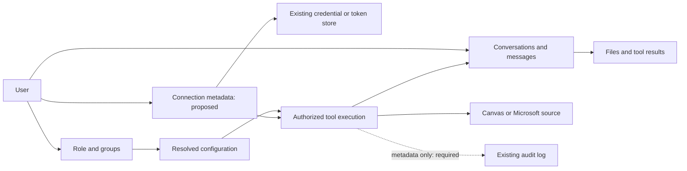

# School backend design

Design version 1, 2026-10-31. Implementation baseline: `10860fb`.

This is the implementation guide for the limited LibreChat school pilot. It
defines ownership, access and storage before adding Microsoft connections. Items
marked **proposed** or **required** are not implemented controls. See
[`school.md`](school.md) for working features and [`microsoft.md`](microsoft.md)
for the agreed read-only scope and IT discussion.

## Decisions and boundaries

- Start with **one institution per deployment**. Reuse LibreChat's existing
  tenant-aware records; a shared service hosting several schools needs a separate
  isolation review. Do not add a second institution/membership system for the pilot.
- Keep native LibreChat chat, agents, tools, files and administration. School
  helpers are configured model specs; they are not new agent identities or users.
- Each person connects their own source accounts. Sharing a helper never lends
  its creator's connection to another person. Being an educator does not grant
  access to students' conversations or connected accounts.
- Microsoft access is **read-only**, including attachments. No sending, Outlook
  drafts, mailbox-state changes, file edits, folder creation or sharing changes.
  There is no planned send/write phase. Canvas remains read-only too.
- Retrieve relevant sources on demand. Do not mirror mailboxes, drives, courses
  or rosters. The institution decides permitted providers and data handling.
- Markdown is the intended working-document format; PDF and Word remain sources.
  No mandatory relationship between a working document and an original, no Word
  editor and no new collaborative-document subsystem.

## Data model: reuse first

Names below identify existing schemas and logical relationships, not a new SQL
database. `tenantId` uses the upstream convention: it may be absent in the current
single-institution deployment; when present it comes from authenticated server
context. Source-account directory IDs must not be substituted for app tenant IDs.

| Record                             | Existing fields/relationship to reuse                                                 | School use and boundary                                                                                                                                                            |
| ---------------------------------- | ------------------------------------------------------------------------------------- | ---------------------------------------------------------------------------------------------------------------------------------------------------------------------------------- |
| User                               | ID, identity-provider identifiers, `role`, `tenantId`                                 | Authenticated owner of chats, files and connections. Retain existing account admission and disable/delete mechanisms.                                                              |
| Role / Group                       | Role permissions; group `memberIds`; tenant scope                                     | Capability gates and configuration profiles. Student/educator policies use these, without a second membership table.                                                               |
| Config                             | Principal type/ID, `priority`, `overrides`, `isActive`, `configVersion`, tenant scope | Existing YAML plus administrator-managed overrides. School settings live at `interface.school`; provider and retention settings retain their existing locations.                   |
| Model spec / Agent / ACL           | Configured helper specs; saved agent resources and resource grants                    | Reuse helper definitions and native sharing. An agent's instructions do not authorize a tool or grant access to a source.                                                          |
| Conversation / Message             | `conversationId`, `messageId`, owner `user`, tenant scope, retention fields           | Existing chat history, including answers and tool content. Connections are resolved for the executing user.                                                                        |
| File                               | `file_id`, owner, storage reference, delivery state, conversation context, expiry     | Existing upload/storage pipeline. The document reader admits current-context files and rechecks owner, tenant and file state.                                                      |
| PluginAuth / existing token stores | User, connector key, encrypted credential value; tenant context                       | Canvas currently uses PluginAuth. Reuse suitable upstream OAuth storage for Microsoft after reviewing refresh, revocation and token exposure.                                      |
| ToolCall / message tool content    | Conversation/message IDs, owner, results and attachments                              | Native activity display and replay. Results can contain private source text; these are content records, not a minimal audit log.                                                   |
| AuditLog                           | Actor, action, target, outcome, request metadata, tenant scope, timestamp             | Existing administrative audit infrastructure. School connection/retrieval events need explicit action definitions and emission; they are not covered merely by having this schema. |



### Small schema additions to design with the connectors

**Proposed connection metadata**, separate from the secret value:

```ts
type SchoolConnection = {
  id: string;
  userId: string;
  tenantId?: string;
  provider: 'canvas' | 'microsoft';
  authority: string; // Institution-approved origin or identity authority.
  remoteAccountId?: string; // Validated provider identity, when available.
  credentialRef?: string; // Server-only; required while connected, cleared on disconnect.
  grantedScopes?: string[]; // When exposed by the provider; never app permissions.
  status: 'connected' | 'reconnect-required' | 'disconnected';
  createdAt: string;
  updatedAt: string;
};
```

This is a logical contract, not a collection already present in the app. Start
with one connection per user/provider, uniquely constrained within its tenant
partition. Keep tokens and refresh tokens out of metadata and API responses;
public status exposes only safe connection state and an approved account label.
Canvas currently stores an encrypted `{ origin, token }` payload directly in
PluginAuth, without this metadata record. An adapter/migration must preserve
existing connections; Microsoft should not introduce a second OAuth subsystem.

**Proposed conversation field:** an access-profile marker such as
`schoolAccessProfile: 'standard' | 'connected-read'`. A conversation permitted to
read sensitive Microsoft sources uses `connected-read` before any retrieval.
Persist it so restoring, branching or continuing that history cannot silently
restore public tools or a different provider. It records a restriction, not an
authorization; current policy and connection access must still be checked.

**Request-local access context**, not another durable collection: authenticated
owner/tenant, conversation ID, resolved policy version/fingerprint, approved model
destination, permitted tool operations, connection reference, admitted files or
source/search scope, and cancellation/deadline. Construct it on the server. The
model supplies query text and resource references, never ownership, credentials
or permission grants. Source references stay in normal context/citations; no
permanent source-to-working-document graph is required.

## Access contract

An operation needs all of: an authenticated admitted user, institution/profile
permission, the applicable role/resource permission, a permitted helper/tool,
the user's valid connection, provider access to the source, and the request's
source boundary. A prompt or a client-side picker cannot replace any check.

Use the existing configuration resolver and its precedence rules. Profile
overrides are not automatically a universal "deny wins" policy. For the sensitive
pilot, the server must additionally enforce the approved provider and operation
allowlist across every available chat/agent route; a user-created agent or another
endpoint must not bypass it. These sensitive-profile checks remain **required**.

Existing school tools reload effective configuration on every execution with
`failClosed: true`; Canvas also reloads the executing user's connection. Preserve
this behavior for Microsoft, including calls in an existing chat. Tenant context
must reach credential/database methods and background work. PluginAuth uses the
upstream tenant-isolation model plugin; an optional `tenantId` field by itself
does not establish isolation. Multi-school hosting remains outside this pilot.

For Microsoft, validate returned account identity and granted read scopes against
the approved connection. Enforce read operations in the adapter as well as using
read-only provider grants. UI source selection does not narrow an OAuth token;
any narrower app boundary needs server enforcement. Reads must not mark mail as
read. Do not expose arbitrary authenticated HTTP requests.

Recheck policy, connection state and permitted disclosure before returning newly
retrieved content to a model if access changed while a request was in flight.
Disconnect must block subsequent retrieval, remove local secrets and cancel
pending reads where possible; provider-side consent revocation is a separate
operation. It cannot retract text already sent to a provider or remove existing
chat history. Microsoft refresh/revocation and these in-flight races need tests.

Use bounded results, downloads, parsing and timeouts; propagate cancellation and
clean up temporary data. Expired authorization should offer reconnection.
Disabled tools, inaccessible sources, empty searches, partial reads and upstream
failures must remain distinct, with safe error codes and honest UI states. Never
persist raw provider exceptions, credentials or signed URLs as user-facing errors.

## Three user flows

**"What assignments are due?" — implemented Canvas path.** The native helper
calls Canvas; the backend reloads school policy and the user's connection, then
lists authorized courses/assignments within limits. The model receives selected
results, source links and retrieval/date context. Native tool activity and chat
history retain the response. Due dates do not establish submission status.

**"Find and summarize the email about the trip." — proposed Microsoft path.**
First apply `connected-read`: an institution-approved model destination and a
restricted set of tools for the entire conversation, including its future turns.
The user's request can authorize a bounded mailbox search and relevant reads
without an approval dialog for every message. The backend constrains the search,
retrieves permitted results/attachments and rechecks disclosure before returning
them to the model. It sends no reply, creates no Outlook draft and changes no mail
state. Candidate search results are sensitive content too.

Initially this profile must exclude public fetching/search, unapproved MCP/action
tools, remote agents, browser/terminal execution and other outward paths. Include
automatic titles, summaries, tracing and memory in the model/data-handling review.
Do not permit switching to a broader profile while carrying this history along.
Use a separate chat without private history if public web work is needed. This is
a proposed pilot boundary, not an implemented automatic data-loss-prevention system.
The ordinary pilot's public-link default remains on; this document changes no
configuration. Sensitive Microsoft access must wait for the restricted path.

**"Read this OneDrive document and help rewrite it." — proposed Microsoft path.**
Authorize the selected file under the user's connection and request scope; retrieve
only what is needed, then extract bounded text through the document pipeline.
Show the source used and generate working text in the assistant, defaulting to
Markdown when a working file is needed. The original remains untouched. Do not
require an original-to-draft binding or silently sync text back to the source.

## Content lifecycle and administrator access

Read-only protects source records from modification. Confidentiality also depends
on where their contents are copied. The following is the **required deployment
contract**; retention periods and hosting arrangements need school agreement.

| Data                                                  | Storage/access contract                                                                                                                                                                                                                                                 |
| ----------------------------------------------------- | ----------------------------------------------------------------------------------------------------------------------------------------------------------------------------------------------------------------------------------------------------------------------- |
| Connection secrets                                    | Existing protected server-side credential/token storage; never model context, browser status payloads, audit metadata or Git. Disconnect clears local credentials.                                                                                                      |
| Raw downloads and parsed text                         | Bounded transient processing by default; no background source mirror. Explicit attachment/import uses the existing owned File storage pipeline. Temporary parsing files are cleaned up.                                                                                 |
| Chat, tool results and generated files                | Treat retrieved excerpts and derived answers as private content. Reuse upstream retention/expiry controls and verify deletion covers messages, tool records, files and copies. The pilot currently persists content.                                                    |
| Citations and audit metadata                          | Keep safe source references in chat. Audit only necessary IDs, operation, time, outcome, policy reference and counts; omit subjects, filenames, search text, bodies, full outputs and signed URLs by default. Metadata itself still needs access control and retention. |
| Search indexes, traces, caches, telemetry and backups | Inventory every enabled copy, its readers and deletion/expiry behavior. A database TTL does not prove files, indexes or backups are removed. Do not send private text to an unapproved observability service.                                                           |
| AI/provider requests                                  | Send only permitted content to the institution-approved destination/account. Document the actual provider handling and retention arrangement; do not promise local-only inference or zero retention.                                                                    |

Separate school configuration management from content inspection. An educator role
does not imply a right to read student chats. Define which operational staff can
inspect content, through which existing privileges, and how that access is recorded
before rollout. Hosting/database operators may technically access stored content;
private sharing defaults do not prevent that. Verify deployment encryption and key
access rather than describing encrypted connection secrets as encryption of all data.

Deleting a chat and disconnecting a source are different actions. Confirm the UI
explains each. User-downloaded exports and copies outside the service cannot be
recalled by deleting the app's records. Upstream retention machinery exists, but
the institution's retention policy and end-to-end deletion verification are pending.

## Implementation sequence and completion evidence

| Stage                          | State and next work                                                                                                                                                                                                                                                |
| ------------------------------ | ------------------------------------------------------------------------------------------------------------------------------------------------------------------------------------------------------------------------------------------------------------------ |
| Current pilot                  | Native helpers, Canvas connection/tools, uploaded-document reading, public fetch/search, school policy controls and existing admin infrastructure are implemented. Brave live search awaits a local key. Microsoft is not connected.                               |
| Backend foundations            | Implement/test the connection adapter and metadata migration, sensitive conversation profile and server-side provider/tool restrictions; extend existing audit actions. Keep new configuration in the shared config schema and database contracts in data-schemas. |
| Developer-only Microsoft pilot | Agree hosting, identity, admitted account, permitted sources/model, retention and operator access with IT. Configure delegated read-only access; implement bounded mail/file tools and native connect/disconnect/reconnect entry points. No bulk indexing.         |
| Broader school pilot           | Validate admission/role policies, permission changes, deletion and operational access with representative accounts before adding students.                                                                                                                         |
| Local execution study          | The developer-only [Study workspace agent](terminal.md) uses native LibreChat command approval and a local SRT worker. Keep it excluded from future sensitive Microsoft profiles until those restrictions are enforced. It is not a school execution deployment.   |
| Deferred                       | Browser automation, multi-school hosting, folder orchestration, merging and collaborative editing remain outside this study. Microsoft sending/writing is excluded, not a promised later feature.                                                                  |

Evidence required for the sensitive pilot: a second user cannot use the developer's
connection or files; model-supplied IDs cannot change ownership; revocation/policy
changes block new disclosure in existing runs; restored/branched chats retain their
restrictions; alternate agents/endpoints cannot export private history; malicious
source instructions cannot invoke an outward tool; no send/write request is
available; secrets stay out of results/logs; bounded reads, reconnect, cancellation
and empty/failure states work; deletion/expiry removes the configured stored copies.
These are acceptance criteria for future implementation, not tests claimed to pass.

## Code map

- Shared school configuration and tool contracts: [`school.ts`](../packages/data-provider/src/school.ts);
  existing provider/retention configuration: [`config.ts`](../packages/data-provider/src/config.ts).
- Existing storage models: [`schema/`](../packages/data-schemas/src/schema);
  tenant enforcement: [`tenantIsolation.ts`](../packages/data-schemas/src/models/plugins/tenantIsolation.ts).
- Configuration resolution: [`service.ts`](../packages/api/src/app/service.ts).
- Current connection/API: [`connection.ts`](../packages/api/src/school/connection.ts)
  and [`router.ts`](../packages/api/src/school/router.ts).
- Native tools: [`tools.ts`](../packages/api/src/school/tools.ts),
  [`documents/tool.ts`](../packages/api/src/school/documents/tool.ts)
  and [`web/tool.ts`](../packages/api/src/school/web/tool.ts).
- Existing retention: [`conversations/retention.ts`](../packages/api/src/conversations/retention.ts)
  and [`files/retention.ts`](../packages/api/src/files/retention.ts).
- Existing audit boundary: [`admin/auditLog.ts`](../packages/api/src/admin/auditLog.ts).

Keep backend behavior in `packages/api`, database schemas/methods in
`packages/data-schemas`, and shared configuration/API types in
`packages/data-provider`. Legacy `api/` remains route wiring. Inject configuration,
storage and provider clients; reuse loaded request data and parallelize independent
reads. This document adds no runtime schemas, migrations, routes or configuration.
