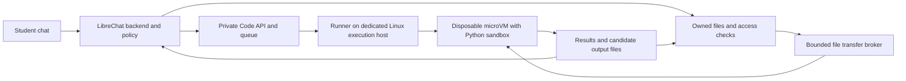

# Server execution architecture

Decision recorded November 8, 2026. This is the intended school execution design;
the existing [local terminal setup](terminal.md) is a developer demonstration.

School users should be able to calculate, analyse supplied data, make plots and
create working files using Python on institution-controlled infrastructure.
Student devices supply the chat interface and explicit uploads. They do not run
agent commands or expose their filesystem. Local-device agents remain a separate
future capability with their own installation, permissions and security review.

## User experience and initial scope

Keep LibreChat's normal code activity, results and attachment UI. The first
execution tool accepts Python source and admitted input-file references, then
returns bounded stdout, errors and generated files. Students can inspect the
code and stop a run. Use institution policy and existing approval controls to
decide when execution needs confirmation; a sandbox must contain code even when
someone approves it without understanding it.

Support calculations, CSV analysis, plots, images made with Python libraries
and Markdown working files. Preinstall a small, pinned scientific/document
library set in the runtime image. Package installation, arbitrary shell tools,
background daemons, Git credentials, browser control and authenticated network
tools are outside the initial student execution surface. Add another runtime
only when a concrete educational use needs it.

Python is an arbitrary-code capability: it can invoke subprocesses and native
libraries. Exposing only Python simplifies the product and runtime; it does not
make the code safe. Do not rely on import bans, command-name filters or model
instructions as the containment boundary.

## Service layout

Reuse LibreChat's Code Interpreter API, jobs, manifests, file handling and result
display. Use the upstream Linux microVM execution path, with NsJail inside the
guest, rather than moving the personal-machine native worker onto a shared
school server. The inspected implementation is pinned in
[terminal.json](../config/terminal.json); deployment should pin a tested compatible
release or commit and its images together.

The execution host is separate from the app/database and from the school's
general network. A school-hosted Linux VM can host the runner if the hypervisor
provides the KVM support needed by the selected microVM backend. Verify this
before choosing the host. If nested virtualization is unavailable, use a host
that supports it or provision disposable execution VMs through a compatible
adapter; do not silently fall back to a shared-kernel sandbox for student code.

The trusted runner creates and tears down guests. Submitted Python runs inside
a guest under resource and syscall restrictions, without access to the runner's
credentials, container socket, control endpoints or host mounts. The app and
queue do not execute submitted source themselves. Keep the upstream hardened
settings, signed execution manifests and authenticated result paths enabled.

This is a deployment and compatibility task, not a new agent framework. The
current local deployment uses a stateful attached workspace; the initial school
compute path should use the upstream ordinary/default execution profile. It
does not require a permanently running terminal or a Git checkout per student.

## Files persist while processes are disposable

Treat each run as a fresh Python process. Python variables, open handles and
background processes do not survive. Files can persist between turns through
app-owned storage, which is separate from VM lifetime.

1. The backend authenticates the user, resolves institution policy and verifies
   access to the conversation and selected files. Model-supplied IDs never
   establish ownership or choose host paths.
2. It records a run identity and captures the admitted input versions. A trusted
   broker stages only those files in the guest's working directory. The guest
   receives neither object-store credentials nor source-account tokens.
3. The runner boots a clean guest, runs the submitted Python within its budget
   and captures bounded output. Parsing of admitted untrusted documents needed
   by a run stays inside the guest.
4. The broker accepts only bounded regular output files from the admitted output
   directory, rejecting symlinks, device files and escaping paths. The backend
   rechecks authorization and publishes accepted outputs through the existing
   owned File and attachment path. Render active output as untrusted content.
5. The runner destroys the guest and its scratch storage on completion, failure,
   timeout or cancellation. The next run receives admitted files again.

Serialize mutations of one conversation's working-file set and publish results
against the captured version. If that version changed, retain a separate output
and report the conflict instead of overwriting newer work. This is protection
against lost writes, not a collaborative editor or a new document history system.
Markdown and images remain ordinary files. PDF/Word are inputs; no automatic
write-back to Microsoft sources is introduced.

Do not present upstream file persistence as an already implemented persistent
school workspace. The fork still needs the admission/transfer integration,
artifact delivery and lifecycle checks for this route. Reuse existing file
records and storage adapters instead of introducing a competing filesystem.

## Network and credential boundary

The guest has no general network access, including internet access, cloud
metadata, loopback control services, the school LAN, DNS tunnelling and other
students' environments. Disable guest networking where practical and enforce
the boundary outside submitted code. Runtime packages arrive through the pinned
image, not a student-controlled installation command.

Canvas, Microsoft, search and model credentials stay with their trusted services.
An app-side tool may retrieve an explicitly admitted input and pass its bytes to
the broker; it must not forward its token. Python output does not get to invoke
another tool or authenticate a request. Uploading an output to an external site
is a separate disclosure decision.

The proposed sensitive Microsoft conversation profile in [backend.md](backend.md)
continues to exclude execution until its provider, content and tool restrictions
are enforced and reviewed. An offline Python guest is not permission to bypass
that profile. A separate network-enabled browser must not become an alternate
route out of a restricted execution conversation.

## Budgets and failure handling

Configure wall time, CPU, memory, process count, input/output bytes, storage,
queue depth and concurrency through institution policy and the shared config
schema. Start short interactive work at the existing 30-second wall-time ceiling;
set measured CPU/memory/storage budgets before deployment. Enforce them in the
runner/guest, not only in the chat request. Queue fairly by user and cap total
active guests so one account cannot exhaust the host or the institution's budget.

Cancellation must terminate the guest and descendants. Retry status retrieval
against the same run ID after a connection loss; do not rerun code merely because
the client missed its result. Distinguish queued, running, awaiting approval,
cancelled, timed out, completed and failed states in native activity. Failed
cleanup fences the runner from reuse and alerts the operator. Logs contain safe
run metadata by default; source, outputs and generated files are private content.

Workspace files, run records, images, traces and backups need explicit expiry and
deletion rules. Deleting a chat must initiate the configured deletion of its
execution files; stopping a VM alone does not delete stored artifacts. Verify
backup handling and operator access before students use the service.

## Implementation order and acceptance

First validate the pinned upstream microVM runner on an isolated Linux host with
synthetic inputs. Then wire the Python-only tool path, file transfer and native
artifact UI. Keep the local native terminal as an operator development option,
excluded from student policy. Browser execution is a separate service described
in [browser.md](browser.md).

Before school use, demonstrate cross-user isolation, rejection of forged file
and run IDs, no host/control/metadata access, no guest network, bounded resource
exhaustion, hard cancellation and descendant cleanup, no secret disclosure,
safe output handling, preserved input versions, idempotent result publication,
revocation during queued/running jobs and deletion of stored outputs. Exercise
startup, empty results, partial failure, restored chats and unavailable workers
through the UI. This document records requirements, not passing deployment tests.

## Existing implementation to reuse

- [Code Interpreter at the inspected revision](https://github.com/LibreChat-AI/code-interpreter/tree/a3207a75c8327ba1c9526eff8b06f3588f3739ed):
  Code API, queue, file service, microVM/NsJail runner and execution profiles.
- [Upstream deployment and isolation notes](https://github.com/LibreChat-AI/code-interpreter/blob/a3207a75c8327ba1c9526eff8b06f3588f3739ed/README.md):
  KVM requirements, shared-kernel limitations and compatible source/image pinning.
- Existing LibreChat configuration, execution capability/role gates, activity,
  approval controls and owned File delivery. Extend these without replacing the
  chat transport or adding a separate institution identity system.
